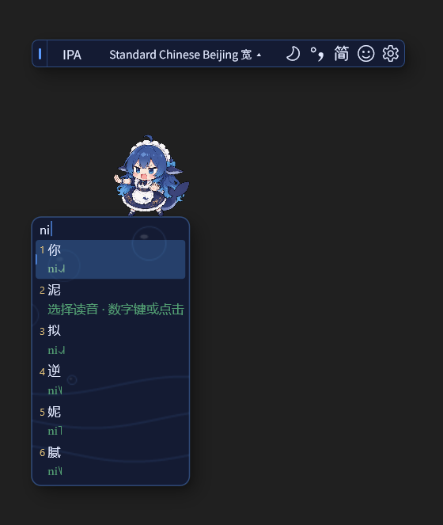
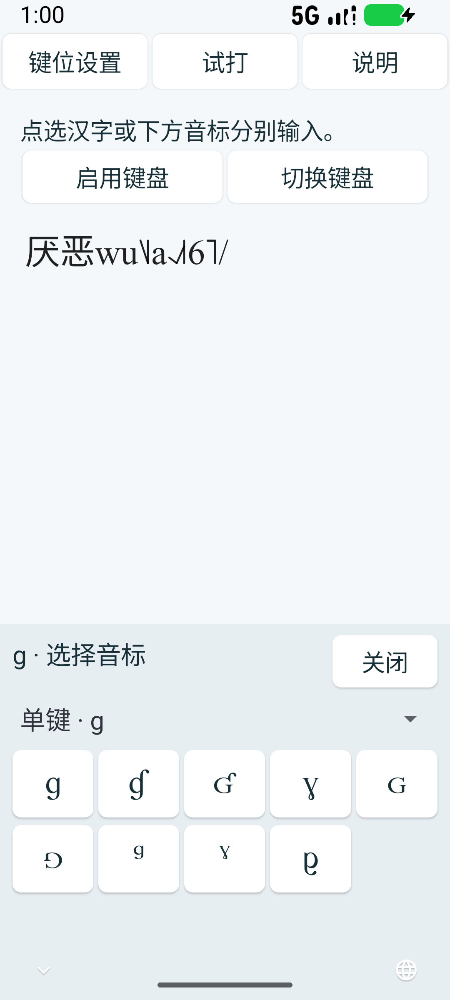
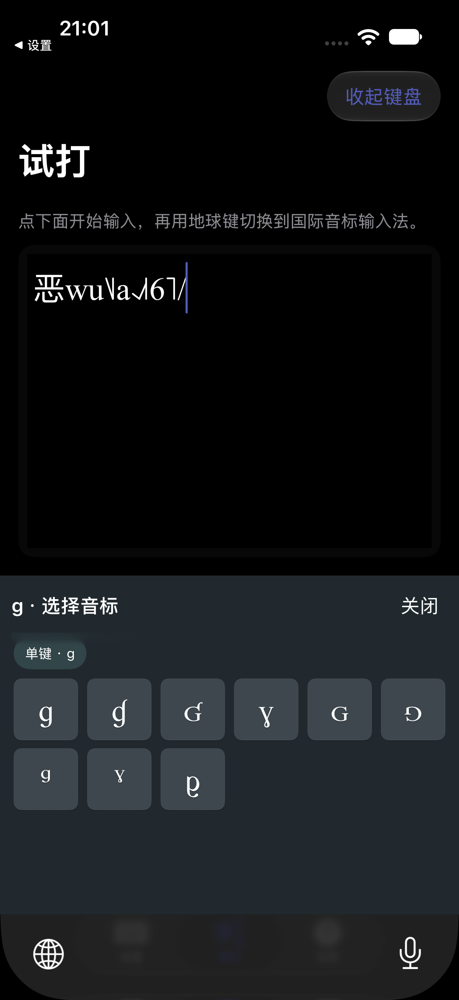
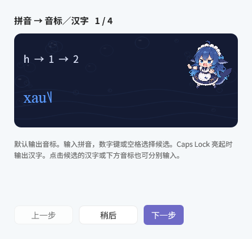
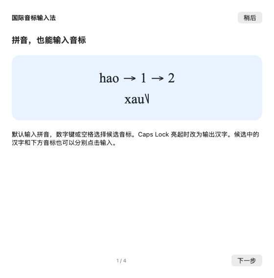
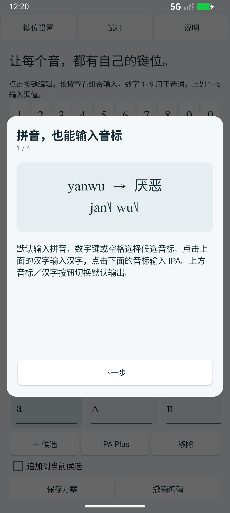

# 国际音标输入法

输入拼音，选择带声调的国际音标；也可以按键位点选 IPA、extIPA 和 VoQS 符号。支持 Windows、macOS、Android 和 iOS。

当前版本 **0.1.5 测试版**。[官网下载](https://www.phonetictoolbox.com/#ipa-ime-download) · [GitHub 下载](https://github.com/Nephelium/phonetic-ipa-ime/releases/tag/ipa-v0.1.5)。iOS 提供需要自行签名的 IPA。

本项目基于 [水杉输入法 MSIME-Windows](https://github.com/metasequoiaime/MSIME-Windows) 开发。感谢水杉原作者及贡献者提供的输入法基础、原生界面与皮肤素材，保留上游历史、GPLv3 及原始署名。

## 两种输入方式

**拼音查字**：默认按数字键或空格选择音标。候选的上行是汉字，下行是 IPA，两行也能分别点击输入。Windows 和 Mac 用 Caps Lock 切换默认输出为汉字，手机使用候选栏的音标／汉字按钮。

**直接输入音标**：Windows 和 Mac 单按 Shift 切换到音标编码。手机点左下角切换，进入后显示 **IPA**。带 `···` 的键短按打开音标选择窗，点哪个就输入哪个；单项输出的键直接输入。

查看 Android 与 iOS 的真实键盘点选画面

 

Windows 图使用产品原生控件渲染。手机图来自项目专用模拟器中的真实系统键盘测试。

## 从第一个字开始

1. 切换到国际音标输入法，保持拼音输入。
2. 输入 `hao`。Windows 也支持用 `h` 查找候选。
3. 选择好对应的候选。有多个读音时，继续选择 `hao3` 或 `hao4`，选定后输入相应 IPA。
4. 输入词语时优先采用词语读音，例如 `yanwu` 对应厌恶。输入 `wu` 时，恶的备选仅保留匹配的 `wu` 读音。

词语不能确定读音时会保留选择，不会直接取第一条。点击汉字行时输入汉字，点击音标行时输入音标。

## 声调、数字与标点

| 操作 | Windows | macOS | Android / iOS |
|---|---|---|---|
| 切换默认音标／汉字输出 | Caps Lock | Caps Lock，或候选栏按钮 | 候选栏音标／汉字按钮 |
| 切换拼音／直接音标 | 单按 Shift | 单按 Shift，或 Shift＋空格 | 左下角切换，音标模式显示 IPA |
| 选择候选或读音 | 1–9、空格 | 1–9、空格 | 点选，或轻点 1–9 |
| 五度调值 | 按住 Shift，依次按 1–5 | 同左 | 上划数字 1–5 |
| 所有符号 | 设置中的 IPA Plus | 设置中的 IPA Plus | 键盘顶部 IPA Plus |
| 切换转写规则 | 工具栏规则名称 | 候选栏规则菜单 | 候选栏规则按钮 |

先确认当前的拼音或音标候选，再输入声调。依次输入调值 `2、1、4`，可以选择 `˨˩˦`、`²¹⁴` 或 `214`。没有候选时，普通数字键输入数字。

直接音标模式可使用 `/`、`\` 等编码。手机先打开符号页。反斜杠收录原数字键上的声调符号，首项是 `˥`；`/` 默认输入斜杠，`0` 保留原码表映射。Windows / Mac 含数字的连续编码可以使用 `code:` 前缀。

Android 按住退格可连续删除，松手或移出按键后停止。选中文字时删除选区。

## 十套转写规则

可在输入时快捷切换，也可在设置中选择：

- Standard Chinese Beijing 宽 / Standard Chinese Beijing 严
- 胡裕树、黄廖、钱乃荣、吴宗济、赵元任、方音字汇
- UntPhesoca 宽 / UntPhesoca 严

每套保留来源表的音标与声调写法。显示名称变化不会改写转写数据。原始列名、参考来源与逐文件 SHA-256 记录在 [Rules-SOURCES.json](prototype/resources/ipa/Rules-SOURCES.json) 和 [来源与许可](prototype/THIRD_PARTY.md)。

## IPA Plus 与键位编辑

手机键盘上方可随时打开 IPA Plus，连续点选 IPA、extIPA、VoQS 符号。先确认已有的拼音或声调候选，再打开音标表。表格可以左右滑动，页面可以上下滑动；手机默认字号为 50%，可以调整。

在设置中点按键位，修改从左到右排列的候选，然后保存。支持导入／导出 CIN 和 JSON，候选页大小可设为 3–9。组合附加符号会显示辅助圆圈和 Unicode 码位，实际输入不包含辅助圆圈。

## 首次使用教学

四个平台首次打开设置 App／窗口会弹出四步教学，之后可在使用说明中重新打开。Windows 安装成功后会主动打开教学，完整解压目录中的 **使用教学.cmd** 也可以随时重看，即使以前已经看过。Windows 使用蓝色大肥鱼示意图，Mac 与手机沿用各自的原生界面。

Windows 新安装默认使用普通蓝色大肥鱼皮肤，皮肤设置保留探头和国庆献礼等其他选择。四个平台统一使用大肥鱼抱着 ə 的应用图标。Windows 的关于页面可以从本机选择 PNG、JPEG、BMP 图片替换设置窗口、任务栏和设置页的显示图标，最大 10 MB；也可以恢复默认。图片仅保存在本机，程序文件图标保留默认大肥鱼。macOS、iOS、Android 不提供任意图片更换图标。

查看四步教学的界面

升级 Windows 输入法后，请保存草稿，并完全退出再打开仍在运行的应用。应用需要重新加载新版输入法 DLL，单关窗口可能仍留在后台，不需要重启电脑。

## 安装

| 平台 | 安装方式 |
|---|---|
| Windows 10 / 11 x64 | 完整解压 ZIP，双击安装启动器，按系统提示注册独立输入法。窗口保留安装结果，错误日志位于 `install-logs`。 |
| macOS 13+，Intel / Apple 芯片 | 完整解压，在终端进入目录后运行 `bash 安装.command`。升级已有安装增加 `--update`。只安装到当前用户的 Input Methods，保留旧版本。需要 Xcode 命令行工具，当前为本地签名。 |
| Android 10+，arm64 / x86_64 | 安装 APK，在试打页启用并切换键盘。测试版使用固定测试签名，升级时保留数据。 |
| iOS 16+ | 自行签名 App 和键盘扩展后安装，再添加系统键盘。详见 [待签名 IPA 安装说明](apple/INSTALL-unsigned.md)。 |

## 更新检查

设置中可手动检查或关闭自动检查。官网和 GitHub 任一版本源提供新版时，提示前往下载，由用户安装。iOS 在配套 App 前台检查。检查请求不包含按键、宿主文本、词库或个人键位方案。

## 来源与许可

本项目基于水杉 Windows `v0.11.1` 的固定源码与历史开发，基线为 `dd018f79858314ed542a47c528608752b13bd261`，保留 GPLv3 与原作者声明。Windows 的 TSF DLL、Server 和原生控件边界保持独立，Apple / Android 复用音标及读音核心。

- 用户编写的 `ipa.cin`、固定字表和本次修改记录见 [来源与许可](prototype/THIRD_PARTY.md) 与 [修改记录](MODIFICATIONS.md)。
- 词语读音采用 CC-CEDICT 衍生资料，保留 CC BY-SA 4.0 署名与修改说明。
- 音标使用 Doulos SIL，扩展缺字使用 PTB IPA Plus，均随包保留 OFL 与来源。文字上屏后的字体由接收软件决定。
- 蓝色大肥鱼沿用水杉上游皮肤素材及作者元数据。抱 ə 的应用图标参考同一角色制作，生成记录见 [图标说明](assets/icons/README.md)。
- 其余依赖的原始声明见 [THIRD_PARTY_NOTICES.txt](THIRD_PARTY_NOTICES.txt)。

## 开发与验证

构建入口分别见 [Windows](prototype/README.md)、[Apple](apple/README.md)、[Android](android/README.md)。当前验证记录见 [0.1.5 代码复核与验证](docs/testing/2026-10-24-015-review.md)。

Windows 原生控件与渲染、两个 TSF 架构、Mac 专用 NSTextView 跨进程输入，以及 Android / iOS 模拟器真实键盘分别记录。iPhone 实机签名与各厂商 Android 实机尚未完成逐一验证。
