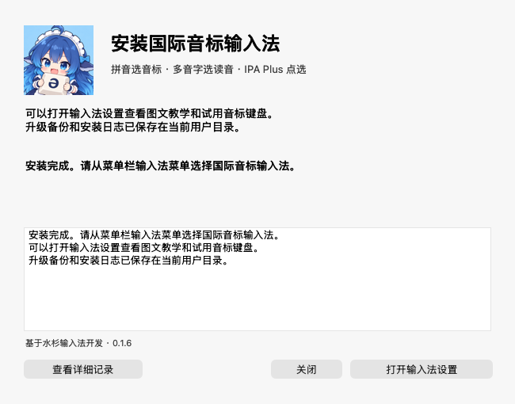

# Mac 双击安装国际音标输入法

适用于 macOS 13 及以上，Intel 和 Apple 芯片。下载 `PhoneticIPA-macOS-0.1.7.zip`，本包已编译好安装器、输入法和注册助手，用户无需安装 Xcode 或命令行工具。

1. 完整解压 ZIP，双击 **安装国际音标输入法.app**。
2. 点击 **安装并启用**。已安装时按钮显示 **升级并启用**，会保留旧版本、键位与规则偏好。
3. 窗口显示安装完成后，点击 **打开输入法设置**，阅读四页教学。
4. 从菜单栏的输入法菜单选择 **国际音标输入法**，再点入需要打字的文本框。
5. 保持 **拼音 → 音标**，输入 `hao`，按好前面的数字，再在 `hao3 / hao4` 中按数字选读音。选 hao4 输入 `xau˥˩`。

当前安装包为本地签名，尚未经过 Apple 公证。如果 macOS 阻止打开，先确认来自官网或本项目 GitHub，再按 [Apple 官方说明](https://support.apple.com/en-lamr/102445) 在系统设置→隐私与安全性中选择仍要打开。无需为此安装命令行工具。

安装位置为当前用户的 `~/Library/Input Methods/PhoneticIPA.app`，无需管理员权限。升级保留旧版本到 `~/Library/Application Support/PhoneticIPA/Install Backups/`，安装器日志在 `~/Library/Logs/PhoneticIPA/Installer/`。安装时保留其他输入源，完成后由用户选择本输入法。

如果安装未完成，窗口会保留记录和重试按钮。先完整解压重新下载的安装包再重试。若系统菜单尚未显示，可在系统设置→键盘→文本输入→编辑中添加国际音标输入法。

## 输入时看什么状态

| 当前候选栏 | 输入方式与下一步 |
|---|---|
| 拼音 → 音标 | 输入拼音，数字／空格选 IPA，有多种读音时再选一次 |
| 拼音 → 汉字 | 输入拼音，数字／空格选汉字 |
| IPA · 点选音标 | 按字母查键位音标，再按数字或空格选候选 |
| tone:214 | 调值尚未确认，选择 ˨˩˦、²¹⁴ 或 214 |

**轻按并松开 Shift** 切换拼音／直接音标，Shift＋空格也能切换。**Caps Lock** 或候选栏音标／汉字按钮切换拼音默认输出。**按住 Shift**，依次按 **2、1、4**，松开后选声调。候选上行汉字、下行音标可以分别点击输入。

更多操作与图例见 [完整新手教程](https://www.phonetictoolbox.com/ipa-ime-guide/) 和 [安装与使用](../docs/INSTALL.md)。本项目基于 [水杉输入法](https://github.com/metasequoiaime/MSIME-Windows) 开发，保留 GPLv3、原作者署名与全部随包资料许可。
