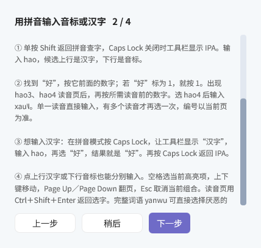
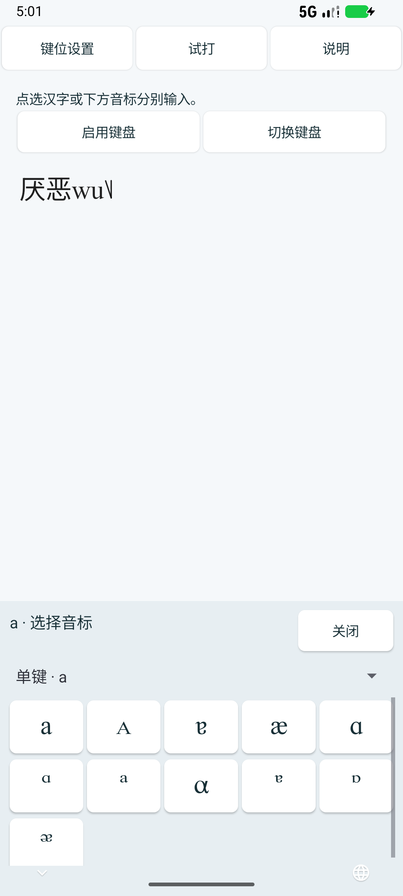
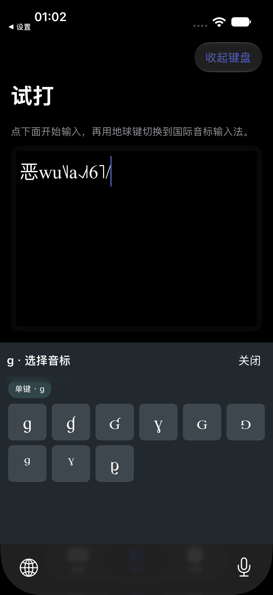
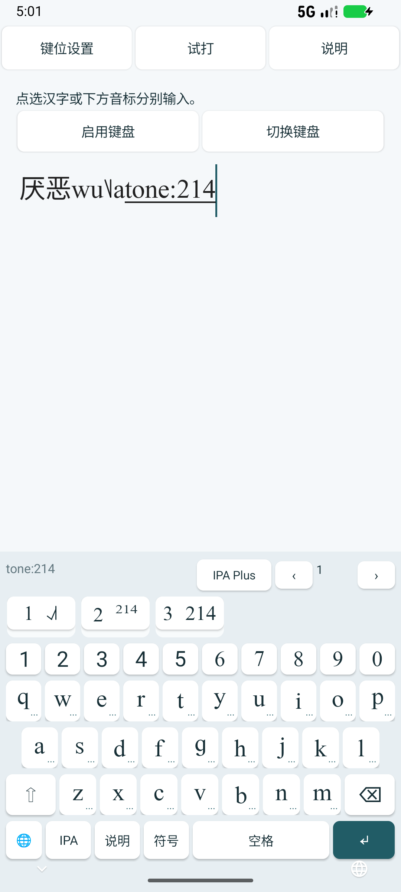
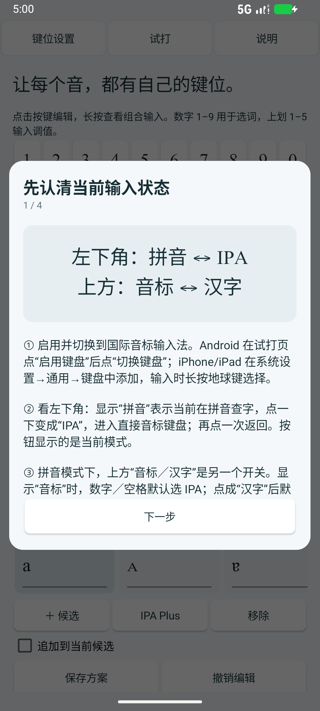
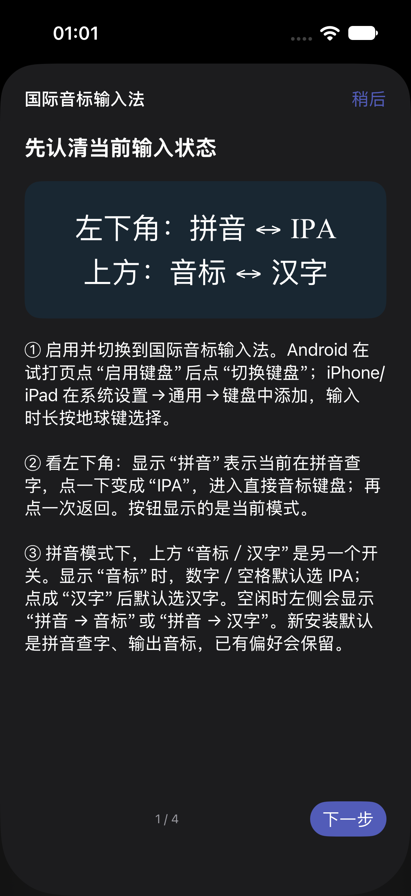

# 国际音标输入法

输入拼音，选择带声调的国际音标；也可以按键位直接查找和点选 IPA、extIPA、VoQS 符号。支持 Windows、macOS、Android 和 iOS。

当前版本 **0.1.7 测试版**。[官网下载](https://www.phonetictoolbox.com/#ipa-ime-download) · [GitHub 下载](https://github.com/Nephelium/phonetic-ipa-ime/releases/tag/ipa-v0.1.7)。Mac 版双击安装，无需命令行工具。iOS 为待签名 IPA。

本项目基于 [水杉输入法 MSIME-Windows](https://github.com/metasequoiaime/MSIME-Windows) 开发。感谢水杉原作者及贡献者提供的输入法基础、原生界面与皮肤素材，保留上游历史、GPLv3 及原始署名。

## 第一次使用：拼音、汉字和音标怎样切换

先在系统中选择 **国际音标输入法**，再点进需要打字的文本框。新安装默认是 **输入拼音，输出音标**；以前保存的模式、规则和键位会保留。

**Windows / macOS 按下面三步切换：**

1. **默认：打拼音，输出音标。** 例如输入 `hao`，按数字选“好”，再按数字选读音，输入对应的 IPA。
2. **按 Caps Lock（大写锁定键）：打拼音，输出汉字。** 继续输入 `hao`，选择候选后输入“好”。再按 Caps Lock，恢复拼音输出音标。
3. **单按并松开 Shift：用字母或符号输入音标。** 进入 **IPA** 直接音标模式，字母和符号用于查找键位上的音标，例如按 `a`，再按 `1` 或空格确认首项。再次单按 Shift，返回拼音输入。

**Android / iOS：** 左下角按钮切换 **拼音／IPA**，显示的是当前模式。拼音模式下，上方 **音标／汉字** 按钮切换输出。还可以随时打开键盘上方的 **IPA Plus**，直接点选要输入的音标。电脑设置中的 IPA Plus 用于查看音标和编辑键位。

**注意：单按 Shift 切换模式；按住 Shift＋1–5 输入声调。** 这两种操作不同。Mac 也支持 Shift＋空格切换输入方式，并可点击音标／汉字按钮切换输出。

| 平台 | 拼音查字，默认输出 IPA | 拼音查字，默认输出汉字 | 直接音标键盘 |
|---|---|---|---|
| Windows 悬浮工具栏 | **IPA** | **汉字** | **IPA** |
| macOS 候选栏空闲状态 | **拼音 → 音标** | **拼音 → 汉字** | **IPA · 点选音标** |
| Android / iOS | 左下角 **拼音**，上方 **音标** | 左下角 **拼音**，上方 **汉字** | 左下角 **IPA** |

直接音标模式统一显示为 IPA。手机左下角显示的是当前模式，点一下会切换到另一种。上方正在显示的拼音、编码或 `tone:214` 是待确认的组合，选定候选后才会输入正文。

## 跟着输入第一个音标

1. 保持拼音查字、输出音标，依次输入 **hao**。候选上行是汉字，下行是对应 IPA。
2. 找到 **好**，按它前面的数字。假如本页好排在第 1 项，就按 **1**。手机也可以点下行音标。
3. 出现 **hao3 / hao4** 读音页后，再按所需读音前的数字，或点击该读音。选择 hao4，输入 **xau˥˩**。只有多个读音时才需要第二次选择，单一读音直接输入。
4. 想输入汉字时，在拼音模式按 **Caps Lock**，或在手机点上方按钮切成 **汉字**。再次输入 hao 并选好，结果是 **好**。
5. 想恢复输出 IPA，再按 Caps Lock，或把手机按钮切回音标。也可以分别点击候选上行汉字、下行音标，明确选择要输入的内容。

候选编号以当前页为准。空格确认首项／高亮候选，再按一次才插入空格。Windows / Mac 用上下键移动、Page Up / Page Down 翻页、Esc 取消组合；读音页用 Ctrl＋Shift＋Enter 返回。手机直接点读音，按退格返回待选内容。

输入完整词语可以使用词语读音，例如 **yanwu → 厌恶 → jan˥˩ wu˥˩**。输入 wu 查到恶时，只保留与 wu 对应的读音。词语仍有歧义时会继续让用户选读音。

## 直接输入单个音标

**Windows / Mac**：单按 Shift，进入显示 IPA 的直接音标模式。先按 **a**，再按 **1** 或空格，确认首项 a。按其他字母可查找相应键位的音标，候选前的数字用于选择。再单按 Shift 返回拼音查字。

**Android / iOS**：点左下角，直到显示 **IPA**。带 **···** 的键有多个音标，**短按一次打开选择面板，再点所需音标**，例如点 g 后选择 ɠ。打开或关闭面板本身不会输入字母。没有 ··· 的单项键直接输入。

 

键位可以在设置的音标键盘中查看或编辑。直接模式可使用 `/`、`\` 等编码，手机先点符号页。`\` 收录声调符号，首项是 ˥；`/` 默认输出斜杠。IPA 模式的 `0` 保留原码表映射，其他普通数字在没有候选时输入数字。Windows / Mac 需要输入含数字的连续编码时，可以使用 `code:` 前缀。

## 加声调：按住 Shift，或上划数字

先确认当前汉字或音标，再输入声调。五度调值 **1 最低、5 最高**。

| 平台 | 输入 214 调值的操作 | 随后会看到什么 |
|---|---|---|
| Windows / Mac | **按住 Shift**，依次按 **2、1、4**，再松开 Shift | `tone:214` 与声调候选 |
| Android / iOS | 在 **2、1、4** 三个数字键上分别 **向上划动** | `tone:214` 与声调候选 |

出现 `tone:214` 时还没有确认声调。选择 **˨˩˦**、**²¹⁴** 或 **214** 中需要的一项。电脑按对应数字，或空格选首项；手机点候选，或空格选首项。手机进入声调组合后，轻点 1–5 可以继续追加调值。

## 随时查完整音标表，切换转写规则

手机键盘上方的 **IPA Plus** 可随时打开完整 **IPA / extIPA / VoQS** 音标表。先确认已有候选，再打开音标表，搜索音标或中文名称后点符号，可连续输入。表格可左右滑，页面可上下滑，默认字号 50%，也能调整。电脑设置中也有 IPA Plus，可用于编辑键位。

**规则**决定拼音查字的转写结果。Windows 点击悬浮工具栏中的规则名称，菜单向上展开；Mac 使用候选栏规则菜单；手机点上方规则按钮。共十套：

- Standard Chinese Beijing 宽 / Standard Chinese Beijing 严
- 胡裕树、黄廖、钱乃荣、吴宗济、赵元任、方音字汇
- UntPhesoca 宽 / UntPhesoca 严

直接音标键盘按自己的键位方案输入。切换拼音转写规则不会替换键位方案。各套音标与声调写法、来源列及 SHA-256 见 [Rules-SOURCES.json](../prototype/resources/ipa/Rules-SOURCES.json) 与 [来源与许可](../prototype/THIRD_PARTY.md)。

## 安装与首次教学

| 平台 | 安装与启用 |
|---|---|
| Windows 10 / 11 x64 | 完整解压 ZIP，双击安装启动器，按系统提示注册。窗口保留安装结果，日志位于 install-logs。输入时用 Win＋空格选择国际音标输入法。 |
| macOS 13+，Intel / Apple 芯片 | 解压 ZIP，双击 **安装国际音标输入法.app**，点安装并启用／升级并启用。**无需 Xcode 或命令行工具**。完成后点打开输入法设置，从系统输入法菜单选择。详见 [Mac 图文安装说明](../apple/INSTALL-macOS.md)。 |
| Android 10+，arm64 / x86_64 | 安装 APK，在试打页先点启用键盘，再点切换键盘，选择国际音标输入法。固定测试签名支持保留数据升级。 |
| iOS 16+，iPhone / iPad | 自行签名 App 与键盘扩展后安装。系统设置→通用→键盘→键盘→添加新键盘，选择国际音标输入法。输入时长按地球键切换。见 [待签名 IPA 安装说明](../apple/INSTALL-unsigned.md)。 |

Mac 当前为本地签名、尚未公证。如果系统阻止打开，请按 [Apple 官方说明](https://support.apple.com/en-lamr/102445)，确认下载来源后在系统设置→隐私与安全性中选择仍要打开。不要安装命令行工具来处理这个提示。

四个平台首次打开设置 App／窗口会显示四页教学。**0.1.6 升级后会补显示一次新版教学**，详细说明模式、按键、候选和声调，之后可在使用说明中重看。Windows 安装完成后会主动打开教学，也可双击解压目录中的 **使用教学.cmd**。教学内容可上下滚动，翻页按钮始终可见。

查看这版详细教学的实际画面

 

## 常见问题与设置

**Shift＋1–5 仍输入 !@#，或 Caps Lock 没反应？** 先确认系统当前选择的是国际音标输入法，并查看上表中的状态。Windows 升级后，保存草稿，完全退出并重新打开仍在运行的应用，使它重新加载新版输入法 DLL。只关窗口可能仍留在后台，无需重启电脑。

**输入字母没有预期音标？** 想拼音查字时回到拼音模式，想选单个音标时进入直接音标模式。手机左下角显示 IPA 时短按带 ··· 的键；电脑显示 IPA 时先按 a，再按 1 试输首项。候选尚未确认时不会进入正文。

**退格与键位编辑**：Android 按住退格连续删除，松手或移出按键后停止。设置中点按键位，按从左到右的顺序编辑候选后保存，支持导入／导出 IPA 码表（.cin）与 JSON、每页 3–9 项。附加符号显示辅助圆圈和 Unicode 码位，实际输入不包含辅助圆圈。

**皮肤与图标**：Windows 新安装默认普通蓝色大肥鱼，保留探头、国庆献礼等其他选择。四端图标为大肥鱼抱 ə。Windows 关于页可选本机 PNG / JPEG / BMP 图片作为设置窗口、任务栏和应用内显示图标，最大 10 MB，可恢复默认；程序文件图标保留默认。图片仅保存在本机。

**更新**：设置中可手动检查或关闭自动检查。官网与 GitHub 任一版本源有新版时提示下载，由用户安装。iOS 在配套 App 前台检查。请求不包含按键、宿主文本、词库或个人方案。

## 来源与许可

基于水杉 Windows v0.11.1，基线 `dd018f79858314ed542a47c528608752b13bd261`，保留 GPLv3 与原作者声明。Windows 沿用 TSF DLL、Server、引擎和原生候选窗，Apple / Android 复用音标及读音核心。

- 用户编写的 ipa.cin、固定字表和本次修改见 [来源与许可](../prototype/THIRD_PARTY.md) 与 [修改记录](../MODIFICATIONS.md)。
- 词语读音采用 CC-CEDICT 衍生资料，保留 CC BY-SA 4.0 署名和修改说明。
- 音标字体 Doulos SIL、扩展字体 PTB IPA Plus 随包保留 OFL 与来源，上屏字体由接收软件决定。
- 大肥鱼沿用水杉上游角色素材和作者元数据。抱 ə 的图标参考同一角色制作，见 [图标说明](../assets/icons/README.md)。
- 依赖声明见 [THIRD_PARTY_NOTICES.txt](../THIRD_PARTY_NOTICES.txt)。

## 开发与验证

构建入口：[Windows](../prototype/README.md)、[Apple](../apple/README.md)、[Android](../android/README.md)。本版记录见 [0.1.6 安装与教学验证](testing/2026-10-25-016-review.md)。分别记录原生控件、两种 TSF 架构、Mac 专用 NSTextView 实际输入和 Android / iOS 模拟器键盘测试。iPhone 实机签名、物理 Intel Mac 和各厂商 Android 实机尚未逐一验证。
