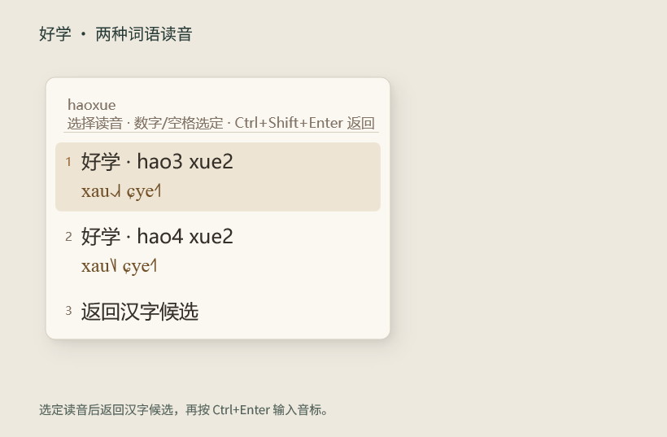
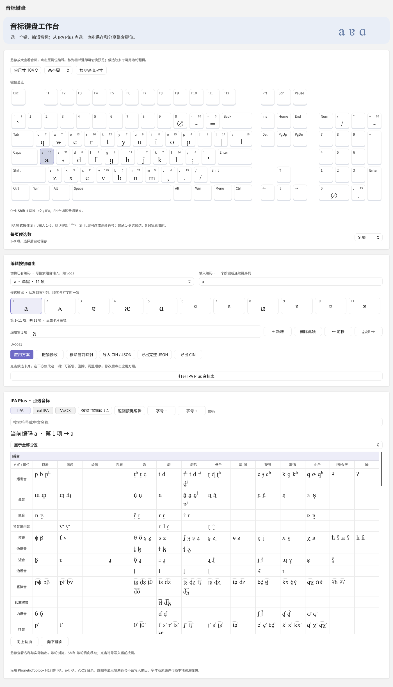

# 国际音标输入法开发原型

基于水杉 Windows v0.11.1 的独立输入法原型，改动日期 2026-10-23。代码位于上层的 `engine/`、`server/`、`windows/` 和 `ui/`，本目录提供原型资源和构建入口。

## 输入和编辑

| 操作 | 行为 |
|---|---|
| 全拼，如 `hanzi` | 汉字候选下方显示北京音 IPA |
| 空格、1–9、点击汉字行 | 输入汉字 |
| Ctrl+Enter、Ctrl+候选数字、点击音标行 | 输入音标，有歧义时先打开读音选择 |
| Ctrl+Shift+Enter、右键候选的切换读音 | 手动重新选择读音 |
| 读音页按数字或空格 | 只确认读音，返回汉字页后再提交 |
| Ctrl+Shift+I | 切换中文与 IPA 码表输入 |
| IPA 模式 Shift+1–5 | 输入上标调值 ¹²³⁴⁵，可在键盘编辑器修改 |
| IPA 模式 `tone:214` | 选择 ˨˩˦、²¹⁴ 或 214 |
| IPA 模式 `code:a10` | 查询包含数字的自定义连续编码 |

候选每页可设为 3–9 项。裸数字 1–9 只用于选候选，原 1 键的 15 项输出移到反斜杠，0 保持原码表映射。设置支持模拟键盘、邻键悬停切换、组合输入预览、横向候选编辑、CIN/JSON 导入导出及 IPA/extIPA/VoQS 选符号。

词语先按标准拼音匹配带调词典。“厌恶”匹配 yan4 wu4；“好学”保留 hao3 xue2 与 hao4 xue2。`wu → 恶` 只提供 wu1/wu4，`e → 恶` 只提供 e3/e4。有歧义时显示选择读音，不自动取第一条。词典未覆盖时逐字选择，无完整结果不提交部分 IPA。当前不做句子语义判音或连读变调。

音标显示使用 Doulos SIL 7.000，缺字回退 PTB IPA Plus。字体私有加载，不安装到系统。纯文本上屏后由接收程序选择字体。

## 构建

需要 Windows、Visual Studio 2022 C++ Build Tools/Windows SDK、CMake、Python 3.10+ 和 vcpkg。建议使用 ASCII 路径。vcpkg 基线为 `04a9d8e5212d01ee1dd9478eadd9caade4f8b0d4`，组件 manifest 保留固定版本。

在仓库根目录执行，`$vcpkgRoot` 指向自己已有的 vcpkg。以下命令不会自动注册输入法：

```powershell
git submodule update --init --recursive
python prototype/scripts/prepare-resources.py
# Server 的 Boost 使用单独的 static-md triplet，按上游构建约定准备：
& "$vcpkgRoot/vcpkg.exe" install boost-asio:x64-windows-static-md --classic
./prototype/scripts/build-prototype.ps1 -Component server -VcpkgRoot $vcpkgRoot
./prototype/scripts/build-prototype.ps1 -Component x64 -VcpkgRoot $vcpkgRoot
./prototype/scripts/build-prototype.ps1 -Component x86 -VcpkgRoot $vcpkgRoot
python prototype/scripts/stage-prototype.py
```

资源准备从本仓固定快照复制 IPA 资源，再按上游 `product-lock.json` 下载并验证汉字词库。词库下载缓存与活动数据库分开，不覆盖已有学习数据。`--skip-dictionaries` 仅用于检查 IPA 资源。设置程序位于 `prototype/output/runtime/PhoneticIpaSettings.exe`。

需要在本机试用输入法时，用户自行以管理员 PowerShell 运行 `prototype/scripts/Register-Prototype.ps1`，再运行 `Start-Prototype.ps1`，在 Windows 输入法菜单选择国际音标输入法原型。注册脚本写入独立 TSF 标识与 `HKLM\SOFTWARE\PhoneticIpa\Prototype`，不覆盖水杉。原型尚无自动升级安装包。

## 验证

2026-10-23 的相应源码已完成 Server/Settings 和 x64/x86 DLL 构建，Server CTest 8/8、TSF 双架构各 17/17、后台原生控件 17/17、通用 UI 原生测试 75/75。x64 和 Win32 客户端均通过真实 Server 管道的词语定调、手动选择、取消重开、wu/e 过滤及两类提交帧检查。

后台原生界面预览：





这些图片来自实际控件的后台绘制。记事本/Word 等真实 TSF 宿主插入、桌面鼠标菜单和跨显示器移动尚待验证。构建成功与 Server 返回提交帧不等于真实宿主验收。

CTest 前将 `METASEQUOIA_IME_DATA_DIR`、`METASEQUOIA_IME_CONFIG_DIR` 指向独立测试副本，并在配置 CMake 时保留该路径。不要直接用日常输入数据运行测试。通用 UI 测试可通过 `-Component ui` 构建。真实通信检查入口 `scripts/Test-ReadingFlow.ps1` 使用两个已编译的 `tests/pipe-probe` 探针及 `output/headless-test-data-path.txt` 指向的隔离配置，配置须使用 raw 预编辑。

## 来源与许可

完整清单见 [THIRD_PARTY.md](THIRD_PARTY.md)，固定资源散列见 [manifest.json](resources/manifest.json)，来源版本及修改见 [provenance.json](resources/provenance.json)。上游代码、词库和依赖声明保留在仓库根 `THIRD_PARTY_NOTICES.txt`。代码采用 GPLv3，字体与不同数据部分保留各自许可。

`scripts/extract-readings.py` 可使用明确提供的原始 M13 JSON 与 CC-CEDICT gzip 重现三个 TSV，校验来源散列和输出散列后写入新目录。日常构建直接使用已固定的资源快照，无须整个 PhoneticToolbox 工程。
